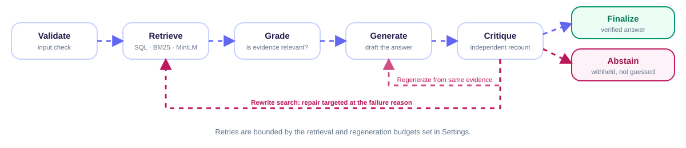
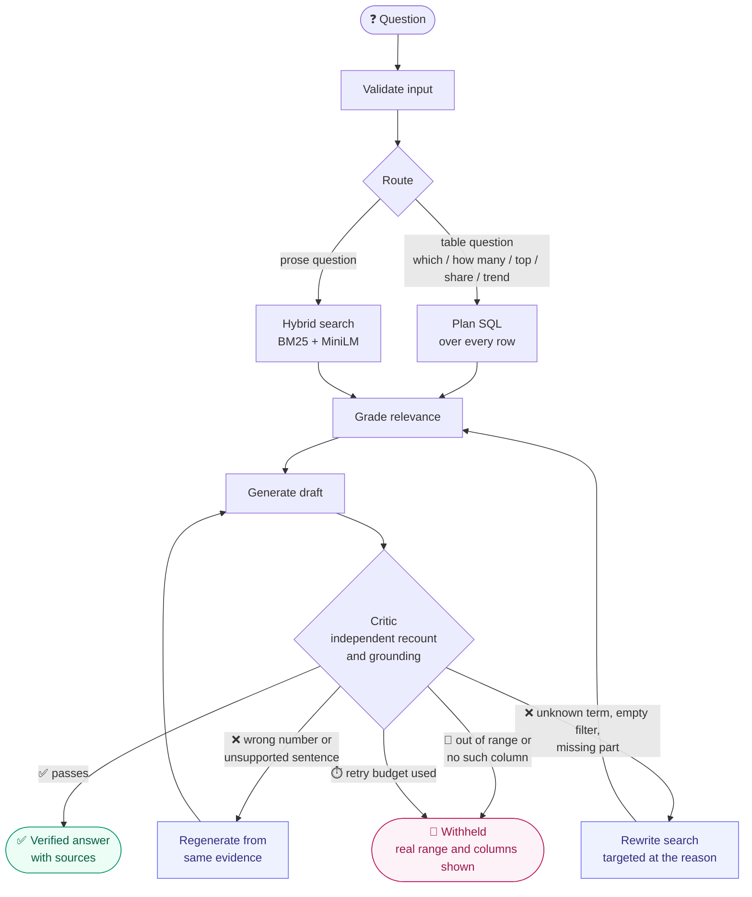
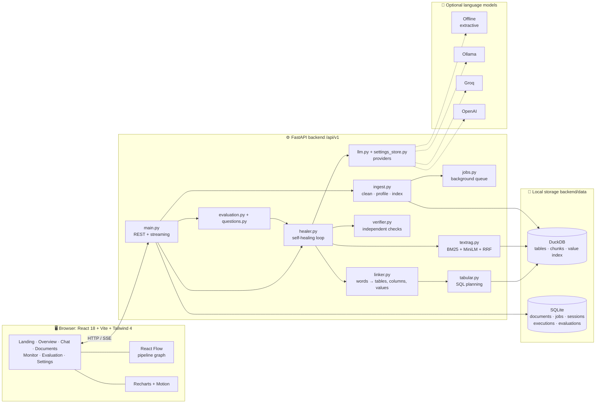
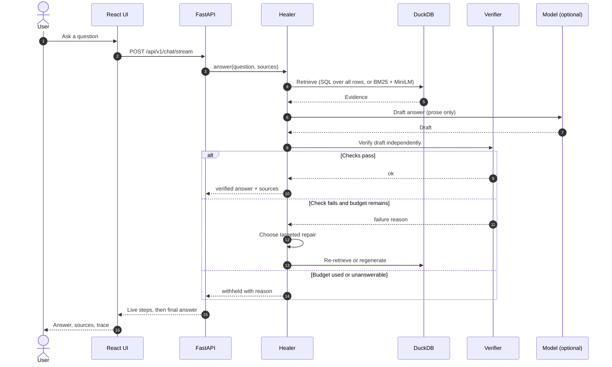

<div align="center">



<br/>

[](https://www.python.org/)
[](https://fastapi.tiangolo.com/)
[](https://duckdb.org/)
[](https://www.sqlite.org/)
[](https://react.dev/)
[](https://www.typescriptlang.org/)
[](https://vitejs.dev/)
[](https://tailwindcss.com/)
[](https://reactflow.dev/)
[](https://pandas.pydata.org/)
[](https://ollama.com/)

**Ask questions about your spreadsheets and documents. Every answer is checked against the data before you see it.
When a check fails, the system repairs the answer or declines to give one.**

[Quick Start](#-quick-start) · [How It Works](#-how-it-works) · [Architecture](#-architecture) · [Datasets](#-datasets-for-analysis) · [Configuration](#-configuration) · [Troubleshooting](#-troubleshooting)


</div>

## Table of Contents

- [Why this exists](#-why-this-exists)
- [Features](#-features)
- [How it works](#-how-it-works)
- [Architecture](#-architecture)
- [Tech stack](#-tech-stack)
- [Project structure](#-project-structure)
- [Quick start](#-quick-start)
- [Run it, step by step](#-run-it-step-by-step)
- [Configuration](#-configuration)
- [Using the app](#-using-the-app)
- [API reference](#-api-reference)
- [Datasets for analysis](#-datasets-for-analysis)
- [Evaluation](#-evaluation)
- [Testing](#-testing)
- [Limits](#-limits)
- [Troubleshooting](#-troubleshooting)
- [Author](#-author)

---

## 💡 Why this exists

Standard RAG retrieves a few passages and lets a language model write whatever sounds right. That fails in two ways:

1. **Counting and ranking questions** ("which township had the most calls?") cannot be answered from the top 8 passages of a 600,000-row table.
2. **Nothing checks the draft.** A fluent but unsupported sentence reaches the user.

**Self-Healing RAG** adds an independent critic. Table questions become SQL over *every* row. Prose answers must be traceable to a cited passage. If the critic fails a draft, the system picks a repair based on *why* it failed, retries within a fixed budget, and otherwise **withholds the answer instead of guessing**.

<div align="center">

</div>

---

## ✨ Features

| | Feature | What you get |
|---|---|---|
| 🔎 | **Exact table answers** | Counting, ranking, top-N, share, sum, average, trend and compare run as SQL over every row (DuckDB). |
| 🧾 | **Independent verification** | The critic recounts numbers itself, checks date ranges and premises, and grounds each prose sentence in a cited passage. |
| 🩹 | **Targeted self-healing** | Each repair is chosen from the failure reason (wrong number, unknown term, empty filter, missing part, unsupported sentence). |
| 🚫 | **Honest abstention** | If the data cannot support an answer, it is withheld with the real date range and the columns that do exist. |
| 🧠 | **Hybrid prose search** | BM25 plus optional all-MiniLM-L6-v2 embeddings, fused with reciprocal rank fusion. |
| 🗺️ | **Live pipeline monitor** | Watch every node of the loop run, with timings and decisions, in an interactive React Flow graph. |
| 📊 | **Overview dashboard** | Verified-rate ring, KPI tiles, 14-day trend, healing reasons, pipeline snapshot and recent questions. |
| 🧪 | **Evaluation lab** | Generates questions with ground truth from *your* data and compares baseline RAG with Self-Healing RAG. |
| 🔌 | **Bring your own model** | Offline (extractive), Ollama, Groq or OpenAI for prose answers. Table answers never need a model. |
| 🔒 | **Local by default** | With Offline or Ollama, documents never leave your machine. API keys stay on the server. |

---

## 🧬 How it works

How each critic failure is repaired:

| Critic finds | Repair (graph node) |
|---|---|
| A number does not match the recount | Rewrite the answer from the recomputed numbers (Verify → Write answer) |
| A sentence is not in its source | Drop that sentence and rewrite from the same evidence (Verify → Write answer) |
| A term maps to no column (e.g. "drunk") | Map it to a real value such as `ALCOHOL INVOLVEMENT`, and add a note (Rewrite search) |
| A filter matches no rows | Relax the narrowest filter, and add a note (Rewrite search) |
| Part of a prose question is not covered | Reformulate the search with the documents' own vocabulary (Rewrite search) |
| The dates asked about are outside the data, or the measure does not exist | Withhold, showing the real date range and the available columns |



---

## 🏗️ Architecture



### One question, end to end



---

## 🧰 Tech stack

| Layer | Technology | Role in this project |
|---|---|---|
| **Language** | Python 3.10+ | Backend, ingestion, verification |
| **API** | FastAPI, Uvicorn, python-multipart | REST and streaming endpoints, file uploads, serves the built UI |
| **Analytics store** | DuckDB | Bulk table loading, SQL over every row, value index |
| **Metadata store** | SQLite | Documents, jobs, chat sessions, execution traces, evaluations |
| **Data handling** | Pandas, NumPy, PyArrow, openpyxl, pypdf | CSV / Excel / Parquet / PDF parsing and cleaning |
| **Prose retrieval** | BM25 (built in), `sentence-transformers` all-MiniLM-L6-v2 (optional) | Hybrid search with reciprocal rank fusion |
| **LLM providers** | Offline (extractive), Ollama, Groq, OpenAI via `httpx` | Prose answers only; tables are computed exactly |
| **Frontend** | React 18.3, TypeScript 5.9, Vite 6 | Single-page app |
| **Styling** | Tailwind CSS 4 | Light glassmorphism UI |
| **Visualization** | `@xyflow/react` 12 (React Flow), Recharts 3 | Pipeline graph, charts |
| **Motion & icons** | `motion`, `lucide-react` | Spring animations, icon set |
| **Routing** | react-router-dom 6 | Client-side routes |
| **Testing** | pytest | API and smoke tests |

---

## 📁 Project structure

```text
Self-Healing-RAG/
├── start.bat                     # One-command start, Windows
├── start.sh                      # One-command start, macOS / Linux
├── sample-data/
│   └── security_handbook.md      # Small sample document
├── backend/
│   ├── requirements.txt
│   ├── requirements-embeddings.txt   # optional: MiniLM (adds PyTorch, ~1 GB)
│   ├── .env.example
│   ├── tests/                    # test_api.py, test_smoke.py
│   └── app/
│       ├── main.py               # API (/api/v1); also serves frontend/dist
│       ├── config.py             # settings, overridable by env vars or backend/.env
│       ├── ingest.py             # single-pass table load, cleaning, profiling, chunking
│       ├── jobs.py               # background indexing queue with live progress
│       ├── healer.py             # the self-healing loop (nodes match the UI graph)
│       ├── linker.py             # question words → tables, columns, real values
│       ├── tabular.py            # SQL planning: top, top-N, share, count, sum, avg, trend, compare
│       ├── verifier.py           # independent recounts, date-range, premise, grounding checks
│       ├── textrag.py            # BM25 + optional MiniLM, reciprocal rank fusion
│       ├── questions.py          # suggestions and evaluation questions with ground truth
│       ├── evaluation.py         # baseline vs self-healing evaluation runs
│       ├── settings_store.py     # providers (Offline, Ollama, Groq, OpenAI), runtime settings
│       ├── llm.py                # OpenAI-compatible client
│       └── meta.py               # SQLite: documents, sessions, executions, evaluations
└── frontend/
    ├── package.json
    ├── dist/                     # prebuilt UI, so Node is optional to just run the app
    └── src/
        ├── pages/                # Landing, Dashboard (Overview), Chat, KnowledgeBase,
        │                         # WorkflowMonitor, Evaluation, Settings
        ├── components/
        │   ├── overview/         # HeroTrust, RingGauge, KpiTile, TrendAreaChart, ...
        │   ├── workflow/         # HealingGraph, TraceTimeline
        │   ├── chat/ landing/ layout/
        │   └── ui.tsx
        ├── lib/                  # api.ts, format.ts
        └── hooks/                # usePoll.ts
```

---

## 🚀 Quick start

### Prerequisites

| Tool | Version | Needed for |
|---|---|---|
| Python | 3.10 or newer | Always |
| Node.js + npm | 18.18 or newer | Only if you edit the UI or the prebuilt `frontend/dist` is missing |
| Git | any | Cloning |

### 1. Clone

```bash
git clone https://github.com/LoganthP/Self-Healing-RAG.git
cd Self-Healing-RAG
```

### 2. One-command start

<table>
<tr><th>Windows (PowerShell or CMD)</th><th>macOS / Linux</th></tr>
<tr>
<td>

```powershell
.\start.bat
```

</td>
<td>

```bash
chmod +x start.sh
./start.sh
```

</td>
</tr>
</table>

The script creates `backend/.venv` and installs `backend/requirements.txt` on the first run (about a minute), builds the UI only if `frontend/dist/index.html` is missing and `npm` is available, then serves **the API and the single-page app together** on:

### 👉 http://localhost:8000

The interactive API docs are at http://localhost:8000/docs.

---

## 🛠️ Run it, step by step

Use this for development with hot reload, or to restart the app later. Two terminals are needed.

### Terminal 1: backend

<table>
<tr><th>Windows (PowerShell)</th><th>macOS / Linux</th></tr>
<tr>
<td>

```powershell
cd backend
python -m venv .venv
.\.venv\Scripts\Activate.ps1
pip install -r requirements.txt
python -m uvicorn app.main:app --reload --port 8000
```

</td>
<td>

```bash
cd backend
python3 -m venv .venv
source .venv/bin/activate
pip install -r requirements.txt
python -m uvicorn app.main:app --reload --port 8000
```

</td>
</tr>
</table>

> **PowerShell blocks the activate script?** Run `Set-ExecutionPolicy -Scope Process -ExecutionPolicy Bypass` once in that window, then activate again.

### Terminal 2: frontend

```bash
cd frontend
npm install
npm run dev
```

Open **http://127.0.0.1:5173**. Requests to `/api` are proxied to the backend on port 8000.

### Restarting later (Windows)

Replace the paths with wherever you cloned the project.

**Backend, Terminal 1**

```powershell
cd C:\path\to\Self-Healing-RAG\backend
.\.venv\Scripts\Activate.ps1
python -m uvicorn app.main:app --port 8000
```

**Frontend, Terminal 2**

```powershell
cd C:\path\to\Self-Healing-RAG\frontend
npm run dev
```

**One-command production mode (optional)**

```powershell
cd C:\path\to\Self-Healing-RAG
.\start.bat
```

This serves the API and the built single-page app on `http://localhost:8000`. To rebuild the UI first, run `cd frontend && npm install && npm run build` (this also type-checks with `tsc -b`).

### Optional extras

<details>
<summary><b>🧠 Semantic search for prose (all-MiniLM-L6-v2)</b></summary>

```bash
cd backend
pip install -r requirements-embeddings.txt
```

This adds PyTorch (about 1 GB). Tables never need it. Without it, prose search uses BM25 only.

</details>

<details>
<summary><b>🤖 A language model for prose answers</b></summary>

1. Copy the example file:

   ```bash
   cd backend
   cp .env.example .env          # Windows: copy .env.example .env
   ```

2. Add a key for a hosted provider, or run Ollama locally:

   ```ini
   GROQ_API_KEY=your-key
   OPENAI_API_KEY=your-key
   OLLAMA_BASE_URL=http://127.0.0.1:11434
   OLLAMA_MODEL=llama3.1:8b
   ```

3. Choose the provider (Offline, Ollama, Groq or OpenAI) on the **Settings** page.

Keys stay on the server and are never sent to the browser. For Ollama, run `ollama list` to see installed models.

</details>

---

## ⚙️ Configuration

Settings are read from environment variables or `backend/.env`. The Settings page can change the healing loop at runtime, **within the hard limits set on the server**.

| Variable | Default | Meaning |
|---|---|---|
| `GROQ_API_KEY` / `OPENAI_API_KEY` | none | Hosted provider keys |
| `OLLAMA_BASE_URL` / `OLLAMA_MODEL` | `http://localhost:11434` / `llama3.1:8b` | Local Ollama |
| `GROQ_MODEL` / `OPENAI_MODEL` | `llama-3.1-8b-instant` / `gpt-4o-mini` | Model names |
| `SHRAG_PROVIDER` | `offline` | Default provider: `offline`, `ollama`, `groq`, `openai` |
| `SHRAG_MAX_ATTEMPTS` | `3` | Searches per question, including the first |
| `SHRAG_MAX_REGENERATIONS` | `1` | Regenerations from the same evidence |
| `SHRAG_TOP_K` | `8` | Passages retrieved for prose questions |
| `SHRAG_SUPPORT_THRESHOLD` | `0.5` | Minimum support for a sentence to count as grounded |
| `SHRAG_USE_EMBEDDINGS` | `auto` | `auto`, `on` or `off` |
| `SHRAG_EMBED_MODEL` | `sentence-transformers/all-MiniLM-L6-v2` | Embedding model |
| `SHRAG_DATA_DIR` | `backend/data` | Where DuckDB, SQLite, uploads and extracted files live |
| `SHRAG_MAX_UPLOAD_MB` | `8192` | Per-file upload cap |
| `SHRAG_MAX_ARCHIVE_MB` | `16384` | Archive upload cap |
| `SHRAG_MAX_ARCHIVE_ENTRIES` | `5000` | Files allowed inside one archive |
| `SHRAG_DEDUPE_MAX_ROWS` | `3000000` | Exact-duplicate removal runs on tables up to this size |
| `SHRAG_DUCKDB_MEMORY` | empty | e.g. `4GB`. Empty uses the DuckDB default (80% of RAM) |

> The full list, with defaults, is in [`backend/app/config.py`](backend/app/config.py).

---

## 🖱️ Using the app

| Page | Route | What it does |
|---|---|---|
| **Landing** | `/` | Product overview |
| **Overview** | `/overview` | Verified rate, KPIs (healing, latency, library), 14-day trend, healing reasons, latest pipeline run, recent questions |
| **Chat** | `/chat` | Ask questions; suggested questions are generated from your indexed data |
| **Documents** | `/documents` | Upload files or zips, watch live indexing progress, see what cleaning removed |
| **Monitor** | `/monitor` | Replay any run node by node with timings and decisions |
| **Evaluation** | `/evaluation` | Run baseline RAG vs Self-Healing RAG on questions generated from your data |
| **Settings** | `/settings` | Pick the provider, tune retry budgets within server limits |

**First run in three steps**

1. Open **Documents** and upload your files, or load the bundled sample (`sample-data/security_handbook.md`).
2. Wait for indexing to finish. Cleaning removes empty rows, exact duplicate rows, empty columns and repeated paragraphs, and the page reports what was removed.
3. Open **Chat** and ask something, then open **Monitor** to see how it was verified.

**Supported files:** `.csv`, `.tsv`, `.xlsx`, `.xls`, `.parquet`, `.jsonl`, `.ndjson` (tables) and `.pdf`, `.txt`, `.md`, `.docx`, `.html`, `.json` (prose), plus zip archives of these.

---

## 🔌 API reference

Base path: `/api/v1`. Interactive docs: `/docs`.

| Method | Endpoint | Purpose |
|---|---|---|
| `GET` | `/health` | Service health |
| `GET` `PUT` | `/settings` | Read or update runtime settings |
| `POST` | `/settings/reload`, `/settings/test` | Reload provider config, test a provider |
| `GET` | `/documents`, `/documents/{id}` | List documents, get one |
| `POST` | `/documents/stream` | Upload with live indexing progress |
| `POST` | `/documents/sample` | Load the bundled sample |
| `DELETE` | `/documents/{id}` | Remove a document |
| `POST` | `/documents/{id}/reindex` | Rebuild an index |
| `GET` | `/documents/{id}/chunks` | Inspect stored passages |
| `GET` | `/suggestions` | Questions generated from your data |
| `POST` | `/chat/query`, `/chat/stream` | Ask a question (plain or streamed steps) |
| `GET` `DELETE` | `/sessions`, `/sessions/{id}` | Chat sessions |
| `GET` | `/executions`, `/executions/{id}` | Pipeline runs and their traces |
| `POST` | `/executions/{id}/feedback` | Submit feedback on a run |
| `GET` | `/analytics/summary` | Everything the Overview page shows |
| `GET` | `/evaluations`, `/evaluations/{id}`, `/evaluations/{id}/export` | Evaluation runs and export |
| `POST` | `/evaluations/run` | Start an evaluation |

---

## 📚 Datasets for analysis

These public Kaggle datasets are good material for trying the system on large tables and real prose. Kaggle requires a free account, and **competition data also requires accepting that competition's rules** on its page. Check each dataset's licence before using it.

| # | Dataset | Link | Good for |
|---|---|---|---|
| 1 | Agent Eval Part I: Grounded RAG Benchmark | [Competition data](https://www.kaggle.com/competitions/agent-eval-part-i-grounded-rag-benchmark/data) | Testing grounded answering against a RAG benchmark |
| 2 | arXiv Dataset (Cornell University) | [Dataset](https://www.kaggle.com/datasets/Cornell-University/arxiv) | Large paper-metadata tables: ranking, counting, trends over time |
| 3 | CORD-19 Research Challenge (Allen Institute for AI) | [Dataset](https://www.kaggle.com/datasets/allen-institute-for-ai/CORD-19-research-challenge) | Scientific prose and metadata about COVID-19 literature |
| 4 | COVID-QA (xhlulu) | [Dataset](https://www.kaggle.com/datasets/xhlulu/covidqa) | Question and answer pairs for checking answer quality |
| 5 | TREC-COVID Information Retrieval | [Competition data](https://www.kaggle.com/competitions/trec-covid-information-retrieval/data) | Retrieval relevance on COVID-19 literature |
| 6 | PDF-VQA | [Competition data](https://www.kaggle.com/competitions/pdfvqa/data) | PDF documents with questions, for the prose and PDF path |

### Download with the Kaggle CLI

```bash
pip install kaggle
# Put your API token (kaggle.json) in ~/.kaggle/  (Windows: C:\Users\<you>\.kaggle\)

kaggle datasets download -d Cornell-University/arxiv
kaggle datasets download -d allen-institute-for-ai/CORD-19-research-challenge
kaggle datasets download -d xhlulu/covidqa

# Competitions: accept the rules on the website first
kaggle competitions download -c agent-eval-part-i-grounded-rag-benchmark
kaggle competitions download -c trec-covid-information-retrieval
kaggle competitions download -c pdfvqa
```

### Analyse them in Self-Healing RAG

1. Start the app (see [Quick start](#-quick-start)).
2. Open **Documents** and upload the downloaded zip or files directly. Uploads up to 8 GB per file are allowed by default.
3. Wait for indexing, then open **Chat** and ask questions such as:
   - Tables (arXiv metadata): *"Which category has the most papers?"*, *"How many papers were submitted in 2020?"*
   - Prose (CORD-19, PDF-VQA): *"What do the documents say about …?"*
4. Run **Evaluation** to compare baseline RAG with Self-Healing RAG on questions generated from the data you uploaded.

> Very large files need RAM. Set `SHRAG_DUCKDB_MEMORY` (for example `4GB`) if your machine is small.

---

## 🧪 Evaluation

The Evaluation page generates questions from your indexed documents, computes the expected answers from the data, and runs both pipelines on them.

| Outcome | How it is scored |
|---|---|
| Correct | The expected value appears in the answer |
| Correct refusal | The question has no valid answer and the system withheld |
| Hallucinated | The question has no valid answer but the system answered |
| Missed | The system withheld a question that had an answer |

Results previously recorded for this project (sandbox, 1 vCPU, 23 questions generated from two large zipped datasets, not re-measured for this README):

| Metric | Self-Healing RAG | Baseline RAG |
|---|---|---|
| Keyword recall | 100% | 50% |
| Unsupported answers | 0% | 61% |
| Correct refusals | 100% | 0% |

Your numbers will differ with your data and hardware. Run the page yourself.

---

## ✅ Testing

```bash
cd backend
python -m pytest -q tests
```

Frontend type-check and production build:

```bash
cd frontend
npx tsc -b
npm run build
```

---

## ⚠️ Limits

- Questions that need **joins across files**, **nested conditions** ("A and not B"), or **ratios between two columns** are declined rather than guessed.
- With **no language model configured**, prose answers quote the documents exactly.
- Semantic prose search needs the optional embeddings package.

---

## 🩺 Troubleshooting

| Problem | Fix |
|---|---|
| `Activate.ps1 cannot be loaded` on Windows | `Set-ExecutionPolicy -Scope Process -ExecutionPolicy Bypass`, then activate again |
| `Port 8000 is already in use` | Stop the other process, or run with `--port 8001` and open that port |
| Blank or old UI at `localhost:8000` | Rebuild: `cd frontend && npm install && npm run build` |
| Overview shows an error note | The backend is not running. Start it, the page recovers on its own |
| Dev UI cannot reach the API | Start the backend on port 8000 first. The Vite proxy sends `/api` there |
| Prose answers just quote the text | No model configured. Add a key or Ollama, then pick the provider in Settings |
| Out of memory on a huge CSV | Set `SHRAG_DUCKDB_MEMORY=4GB` (or lower) before starting |
| `pip install` is very slow | You installed `requirements-embeddings.txt` (PyTorch, ~1 GB). It is optional |
